<p align="center">
  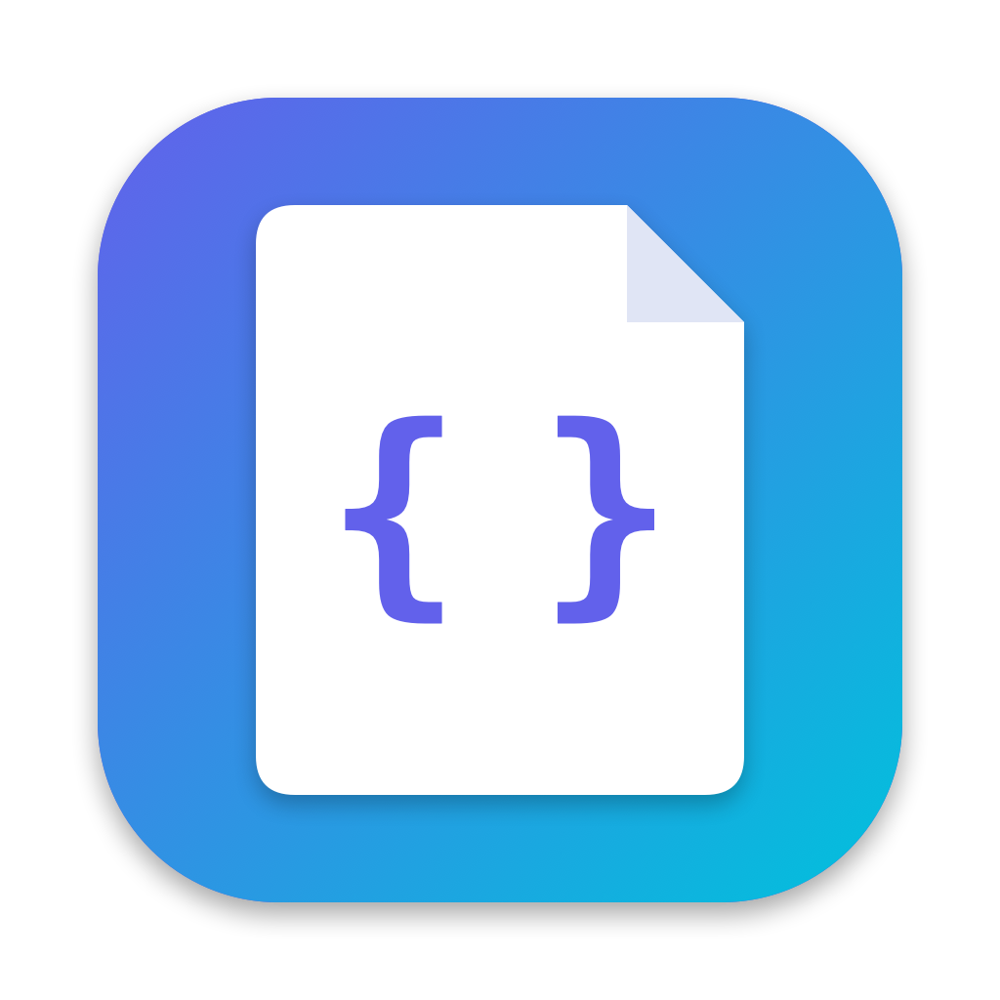
</p>

<h1 align="center">coTs</h1>

<p align="center"><b>English</b> · <a href="README.es.md">Español</a></p>

<p align="center">
  <b>Code notes for you and your AIs.</b><br>
  A menu bar app for macOS and a tray app for Windows where Claude Code, Codex or Gemini save reports, logs and plans, and where you read, edit and approve them.
</p>

<p align="center">
  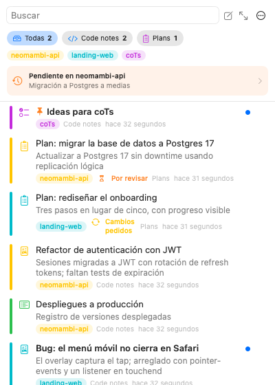
  &nbsp;
  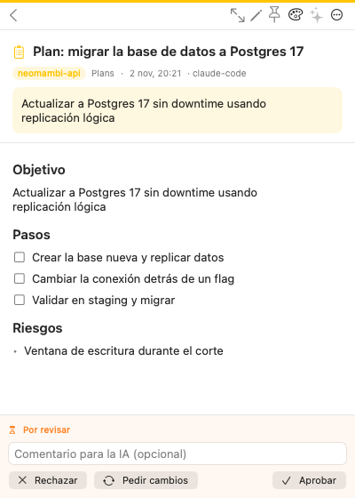
  &nbsp;
  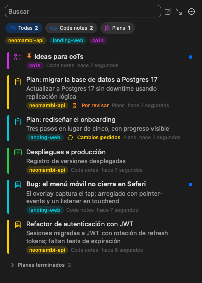
</p>

<p align="center"><sub>Screenshots show the app in Spanish; it follows your system language (English and Spanish).</sub></p>

---

## What it does

- **"save in cots"** stores the AI's last reply verbatim in ~0.3 s and **without spending tokens**: in Claude Code a hook catches the phrase before it reaches the model.
- **"let's make a plan in cots"**: the AI writes a plan, you review it in the app (you can edit it) and click **Approve**, **Request changes** or **Reject**. The AI, which was waiting without consuming tokens, continues on its own with your decision and your version of the plan.
- **Never lose the thread**: every AI session keeps saving its last message to a hidden note for the project. If the session closes or the Mac shuts down, the next time a session starts in that project coTs notifies you, and the AI gets a one-line recap of where it stopped.
- **"what's pending in cots?"** answers with the open tasks and plans awaiting review of the project you opened the agent in, without asking which one. Outside a project it lists them all.
- **Topics and colors**: each note is tagged automatically with the project (git repo) the AI was working in, and each topic always gets the same color. You can also pick a color per note.
- **Just Markdown files**: your notes are plain `.md` files in `~/coTs`. Open them with any editor, version them or sync them.
- **Always at hand**: it lives in the menu bar (macOS) or the system tray (Windows), starts at login and shows how many notes are unread and how many plans await your review.
- **English and Spanish.**

## Apps

| | macOS | Windows |
|---|---|---|
| App | Menu bar, SwiftUI (`apps/macos`) | System tray, Tauri (`apps/windows`) |
| Notes, CLI, skill, hooks, MCP | Shared | Shared |
| Download | `coTs-<version>-macos-universal.dmg` | `coTs-<version>-windows-x64-setup.exe` |

Both read the same notes folder through the same `cots` CLI, so a notes folder synced between a Mac and a PC works on both. Downloads are on the [releases page](https://github.com/fresnohernandez99/cots/releases): release candidates are pre-releases named "coTs x.y.z RC n".

<p align="center">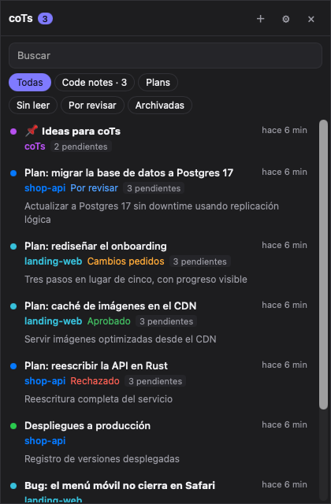</p>

## Install

### Windows

Run `coTs-<version>-windows-x64-setup.exe`. It installs for your user (no admin rights), adds `cots` to your PATH, and on first launch installs the skill, the Claude Code hooks and the Claude Desktop MCP server, like the Mac app. Click the tray icon to open your notes; right-click it for **New note**, **Open notes folder**, **Start at login** and **Settings**. Uninstalling from Windows Settings removes all of that too, never your notes. The installer isn't code-signed yet: if SmartScreen warns, choose **More info → Run anyway**.

### macOS

1. Open `coTs-<version>-macos-universal.dmg` and drag **coTs** to **Applications**.
2. Open it. On first launch it sets up:
   - launch at login;
   - the `cots` CLI in `/usr/local/bin` (or `~/.local/bin`);
   - the AI skill in `~/.claude/skills/cots` (Claude Code) and `~/.agents/skills/cots` (Codex, Gemini CLI, Antigravity);
   - the Claude Code hooks in `~/.claude/settings.json` (direct save and sessions), leaving your other hooks untouched;
   - the MCP server in Claude Desktop, if it's installed;
   - notification permission, which macOS will ask you for.
3. Start a new session of your agent so it loads the skill.

<p align="center">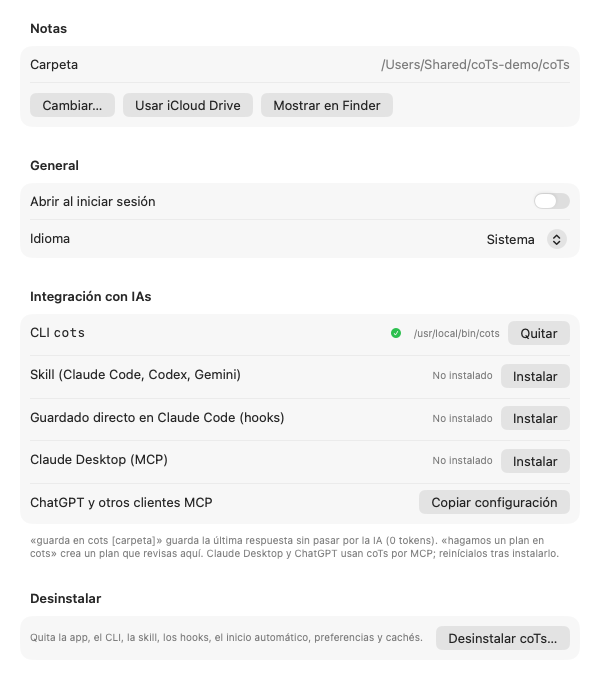</p>

**Settings → AI integration** shows the status of each piece, lets you reinstall or remove it, and lists errors if something couldn't be installed.

**Uninstall:** **Settings → Uninstall coTs…** removes:
- the app (to the Trash);
- the CLI, skill and hooks;
- the login item;
- preferences and caches.

Your notes are only removed if you tick the box, and they go to the Trash too.

## Talking to your AI

| You say | What happens |
|---|---|
| `save in cots` | Saves its last reply to `code-notes`. In Claude Code it never reaches the model. |
| `save in cots ideas` | Same, into the `ideas` folder (created if missing). The Spanish `guarda en cots …` works too. |
| `save a summary with the open tasks in cots` | The AI writes what you asked for and saves it. |
| `let's make a plan in cots for …` | The AI creates a plan in `plans` and waits for your decision. |
| `check my cots notes for this project` | The AI lists titles and summaries (cheap on context) and only opens what it needs. |

### The plan loop

<p align="center">
  
  &nbsp;
  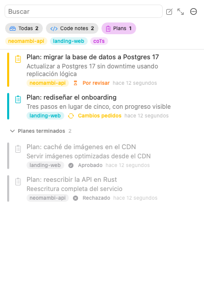
</p>

```
AI:  cots plan …  ──►  shows up in coTs › Plans (orange badge)
AI:  cots wait <id> (in the background, 0 tokens)
You: read, edit, comment → Approve / Request changes / Reject
AI:  wakes up with  review: approved|changes|rejected + comment + final plan
AI:  on changes, cots plan --replace <id>  ──►  same plan, new version, pending again
```

Requesting changes never leaves two plans behind: the agent's revision replaces the plan in place, with the same id.

Approved and rejected plans turn gray and move into the **Finished plans** subsection.

### Pick up where you left off

<p align="center">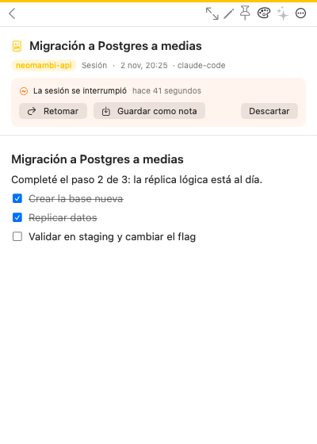</p>

1. While you work, the `Stop` hook saves each session's last reply with detail to `~/coTs/_sessions/<project>--<session>.md`. Short wrap-ups ("done, 40 tests pass and it's in prod") are skipped: only replies with code, tables, headings or a long explanation count. It's a hidden note: it doesn't show up in lists.
2. `SessionEnd` records whether the session closed normally. If it crashes or you shut down the Mac, that signal never arrives, and that's fine.
3. When a new session starts in the same project, `SessionStart`:
   - tells coTs, which shows a **macOS notification** and an orange banner in the popover;
   - gives the AI a few lines with the last message and the note id (~100 tokens).
4. In the note you choose what to do:
   - **Resume** copies a prompt to continue;
   - **Save as note** keeps it in `code-notes`;
   - **Dismiss** clears the reminder.

   The note stays under **Expanded window → System → Sessions** until the new session's own last message replaces it. If the new session leaves none, it's removed when the next one starts. Each project keeps a single last message, not a pile.

### Claude Desktop and ChatGPT (MCP)

Apps without a terminal or hooks use coTs through its MCP server, `cots mcp` (stdio). It offers these tools:
- `list_folders`, `list_notes`, `search_notes`, `read_note`;
- `save_note`, `append_to_note`;
- `create_plan`, `get_plan_review`.

- **Claude Desktop:** coTs registers itself in `claude_desktop_config.json` on first launch, or from **Settings → AI integration**. Restart Claude Desktop afterwards.
- **ChatGPT desktop and other MCP clients:** **Settings → AI integration → Copy configuration** gives you the command (`…/coTs.app/Contents/Resources/cots`) and its argument (`mcp`). Add them as a local MCP server (in ChatGPT: Settings → Plugins).

Without hooks, "save in cots" costs tokens there, because the model has to send the text. For plans, the AI creates one, you review it in coTs, tell it "done", and it reads your decision with `get_plan_review`.

## The app

<table>
  <tr>
    <td align="center">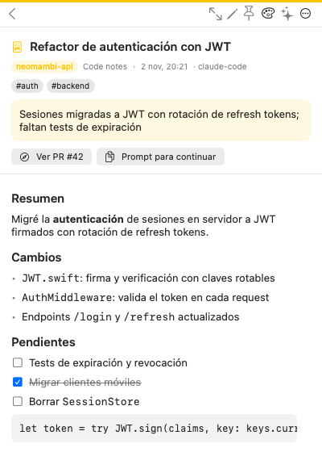<br><sub>A note: summary, actions and checklist</sub></td>
    <td align="center">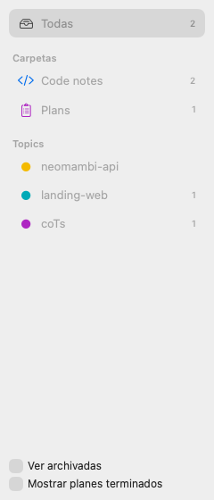<br><sub>Expanded window sidebar</sub></td>
    <td align="center">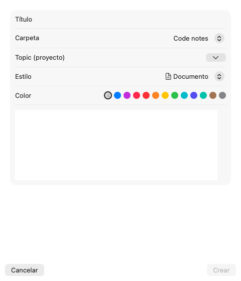<br><sub>New note: folder, topic, style and color</sub></td>
  </tr>
</table>

- **Menu bar icon:**
  - left click opens the popover: search, folder and topic chips, list and note details. The ⤢ button opens the expanded window;
  - **right click** (or ⌃-click) opens the general menu: New note, Open expanded, Open notes folder, Show archived, Show finished plans, Open at login, Settings and Quit.
- **Expanded window:** sidebar (All · Folders · Topics · System), list and detail. While it's open, coTs shows in the Dock and the menu bar:

| Menu | Shortcuts |
|---|---|
| File | New note ⌘N |
| Note | Read/unread ⌘⇧U · Pin ⌘⇧P · Color · Copy ID ⌘⇧C · Show in Finder ⌘⇧R · Archive ⌘⇧A · Trash ⌘⌫ |
| View | All ⌘0 · Folders ⌘1–⌘9 · Show archived ⌘⇧H · Show finished plans |

- **On each note:** edit, pin, color 🎨, AI context ✨ (hidden by default), the note's own action buttons and the … menu with the rest. All of it is also available by right-clicking in the list.
- **Styles:**
  - `document`;
  - `report`, with the summary highlighted;
  - `checklist`, with clickable boxes;
  - `log`, a timeline;
  - `code`;
  - `plan`.

## Note format

Each note is `~/coTs/<folder>/<YYMMDD-HHMM>.md`. The frontmatter has three layers, each for a different reader:

```yaml
---
# 1. Identity: you see it in the app; the AI reads it with `cots list` without opening the body
title: Auth module refactor
summary: Moved sessions to JWT; expiry tests missing
status: unread            # unread | read | archived
topic: shop-api       # project, detected from the repo
tags: [auth]
source: claude-code

# 2. Display and actions: how it looks and which buttons it has
display: { style: report, color: blue, pinned: false }
actions:
  - { type: open_url, label: Open PR, url: https://… }
  - { type: copy, label: Prompt to continue, text: "…" }
  - { type: run, label: Tests, command: swift test }   # always asks for confirmation

# 3. AI context: hidden in the app; only `cots read --ai`
ai:
  cwd: /Users/me/code/repo
  branch: feat/jwt
  files: [Sources/Auth.swift]
  next: [Add expiry tests]
  context: Decisions and pitfalls for the next AI.

review: { status: pending, comment: "…" }   # plans only
---
## Summary
The body is for you.
```

Unknown keys are always preserved. Each folder can have a `_folder.yml` with a title, icon, color, defaults and instructions or a template for AIs. `cots schema` prints the full reference.

## CLI

```bash
cots add <folder> --title … [--summary …] [--style …] [--color …] [--ai JSON] [--action 'type|label|value'] < body.md
cots add code-notes --from-last-reply        # uses the last reply captured by the hook
cots plan --title … < plan.md                 # creates a pending plan
cots plan --replace <id> < plan.md            # revises that plan after you request changes
cots wait <id> [--timeout s]                  # blocks until you decide
cots review <id> approved|changes|rejected [--comment …]
cots list [folder] [--here | --topic X] [--unread] [--json]
cots pending [--topic X | --all-projects]     # open tasks and plans to review, current project by default
cots check <id> "part of a task" [--all]      # ticks tasks off
cots setup [--status] [--remove]              # skill, hooks and MCP pointing at this cots
cots read <id> [--ai] [--raw]                 # <folder>/latest = the most recent
cots search "text" [--here] · cots append <id> · cots trash <id> · cots set <id> --status … --pin
cots folders · cots folder <name> · cots mkdir <name> …
cots mcp                                      # MCP server over stdio
```

## Storage

Notes live in `~/coTs` by default. In **Settings** you can pick another folder, or **iCloud Drive** to see them on your iPhone in the Files app. The app and the CLI share their configuration in `~/.config/cots/config.json`; the `COTS_HOME` variable overrides it.

## Development

The core and the CLI are Swift 6 and build on macOS, Windows and Linux. Dependencies: [Yams](https://github.com/jpsim/Yams) and [swift-argument-parser](https://github.com/apple/swift-argument-parser). The Windows app also needs Rust and Node.

```bash
swift build && swift test

# macOS app (macOS 14+)
apps/macos/scripts/make-dmg.sh      # ad-hoc signed build/coTs.app + build/coTs-<version>-macos-universal.dmg
apps/macos/scripts/install.sh       # shortcut: build and copy to /Applications
swift apps/macos/scripts/make-icon.swift .   # regenerates the icon (then iconutil, see the script)

# Windows app (also runs on macOS for development)
apps/windows/scripts/prepare-cli.sh # or prepare-cli.ps1 on Windows: builds cots next to the app
cd apps/windows && npm install && npm run dev

# Visual QA without a screen: sample data + renders of the real views
# (the README screenshots come from here, copied to docs/screenshots)
scripts/fixtures.sh /tmp/cots-fx/notes
COTS_HOME=/tmp/cots-fx/notes .build/debug/CotsApp --snapshot /tmp/cots-fx/shots -AppleLanguages "(es)" -AppleLocale es_ES
```

| Path | Contents |
|---|---|
| `core/CotsCore` | Shared by every app. `Model` (note types, pending tasks), `Format` (YAML frontmatter), `Storage` (store, note cache, `NoteDraft`) and `Agents` (sessions, reply cache, Claude Code hooks, MCP server). |
| `core/CotsIntegrations` | What gets installed for agents (CLI link, skill, Claude Code hooks, Claude Desktop MCP), each with install, remove and status. |
| `core/Tests` | Tests for both. |
| `cli` | `cots`, one file per command in `Commands/`. Every app ships it. |
| `apps/macos` | SwiftUI menu bar app: `Sources` (`Model`, `Popover`, `Window`, `Settings`, `Components`), `Resources` (icon, `es`/`en` translations) and `scripts` (build, DMG, install). |
| `apps/windows` | Tauri tray app: `src` (the window, HTML/JS) and `src-tauri` (Rust: tray, CLI calls, Markdown, folder watcher, installer). |
| `skills/cots/SKILL.md` | Skill in the open Agent Skills format; `scripts/package-skill.sh` builds the ZIP for Agensi. |
| `assets` | Icon source shared by both apps. |
| `scripts` | Version (`set-version.sh`, `check-version.sh`), skill package and sample data. |
| `docs` | Screenshots, [how to release](docs/RELEASING.md), release notes and the Agensi listing. |

To distribute to other Macs without the "unidentified developer" warning, sign with a Developer ID and notarize.

## Roadmap

- iOS app reusing `CotsCore`.
- System notifications on macOS when an AI leaves a note (Windows already has them).
- Code signing for the Windows installer.
